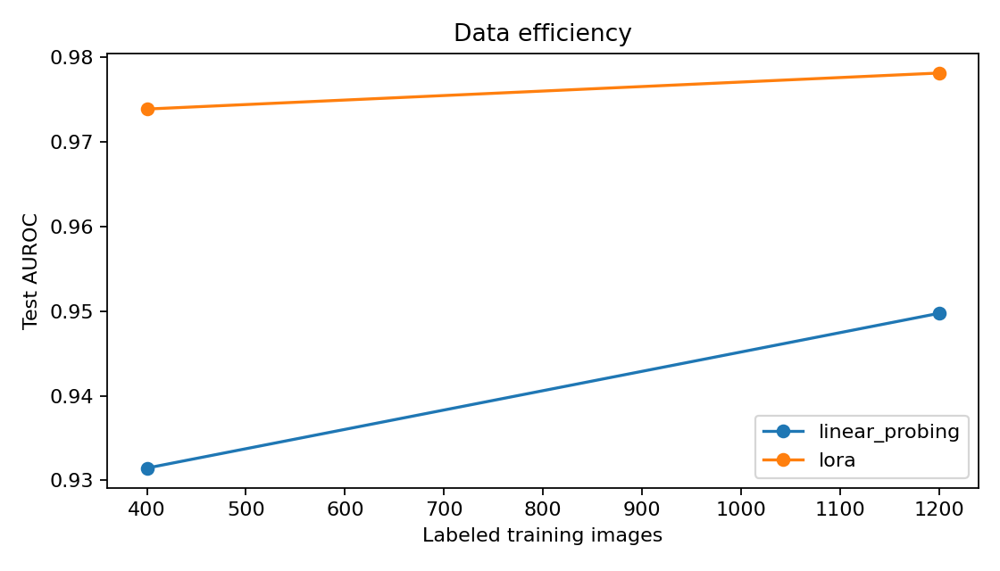
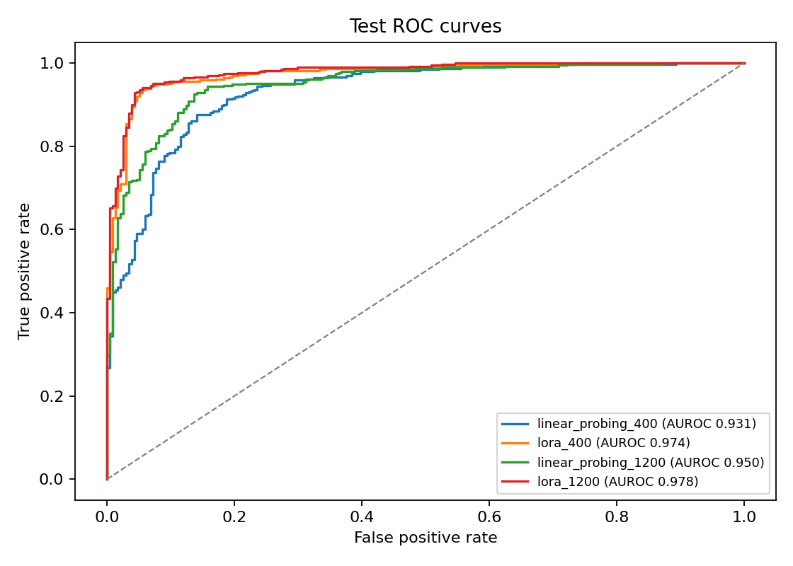
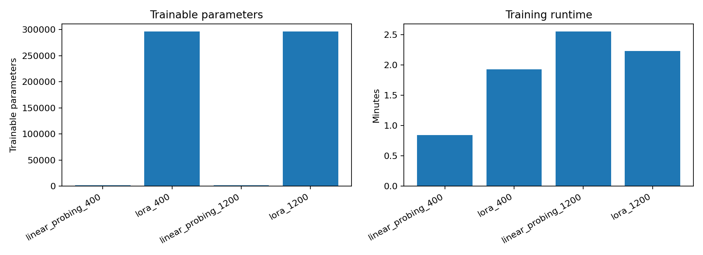
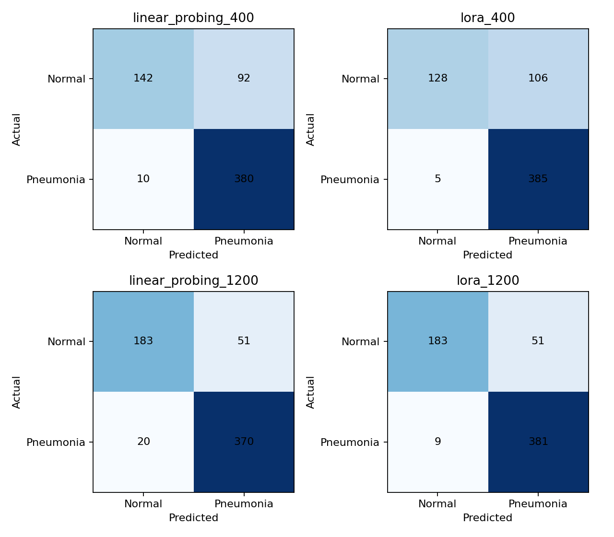

# Data-Efficient ViT Adaptation for Chest X-Ray Classification

**An applied ML portfolio study of Linear Probing vs Low-Rank Adaptation (LoRA)** on a pretrained Vision Transformer. The experiments reported below were run on **2 November 2026**, using **one random seed (42)** and the official **PneumoniaMNIST+** train/validation/test splits.

> **Research scope:** exploratory research/engineering benchmark on pediatric chest X-rays. These models are **not clinically validated**, and the results do not support medical diagnosis or deployment.

## Research question

How does the number of labeled medical images affect the **discriminative performance** and **computational cost** of adapting a pretrained ViT with a frozen encoder (Linear Probing) versus LoRA?

## Main findings

| Adaptation | Labeled train images | Test AUROC ↑ | Test balanced accuracy ↑ | Sensitivity | Specificity | Trainable parameters | Train time |
|:--|--:|--:|--:|--:|--:|--:|--:|
| Linear Probing | 400 | 0.9315 | **0.7906** | 0.9744 | 0.6068 | 1,538 | 50.8 s |
| LoRA | 400 | **0.9739** | 0.7671 | 0.9872 | 0.5470 | 296,450 | 115.7 s |
| Linear Probing | 1,200 | 0.9497 | 0.8654 | 0.9487 | 0.7821 | 1,538 | 153.1 s |
| LoRA | 1,200 | **0.9781** | **0.8795** | 0.9769 | 0.7821 | 296,450 | 133.8 s |

**Observed on this split (not a statistical superiority claim):**

- LoRA improves **test AUROC** over Linear Probing by **0.0424** at 400 images and **0.0284** at 1,200 images.
- LoRA with 400 images (0.9739 AUROC) exceeds Linear Probing with 1,200 images (0.9497 AUROC), although the methods use different trainable parameter counts, optimization settings, and update budgets. This is a **descriptive observation**, not a fair-compute comparison.
- **AUROC and operating-point performance differ:** at the predefined 0.5 threshold, LoRA-400 has **lower balanced accuracy** than LP-400 (0.7671 vs 0.7906). Specifically, false positives increase from **92 to 106** while false negatives decrease from **10 to 5**.
- At 1,200 images, both methods have **51 false positives**; LoRA reduces false negatives from **20 to 9**.
- Linear Probing has only 1,538 trainable parameters versus 296,450 for LoRA. Training-time comparisons must account for unequal epochs/optimizer updates, and the LoRA configurations use more allocated GPU memory.

All rows above come from the experiment exports in [`results/metrics.csv`](results/metrics.csv). *No test-set hyperparameter tuning was performed in the documented protocol.*

## Figures from the recorded run







<details><summary>Confusion matrices at the predefined 0.5 decision threshold</summary>



</details>

## Experimental design

- **Dataset:** MedMNIST+ / PneumoniaMNIST at 224 × 224 pixels, binary classification: `NORMAL` (0) vs `PNEUMONIA` (1). Official splits: **4,708 train / 524 validation / 624 test**. These are pediatric radiographs; external applicability is unknown.
- **Annotation budgets:** fixed stratified train subsets of **400** and **1,200** images; the 400 indices are nested within the 1,200 indices and identical across methods at a given budget.
- **Backbone:** Hugging Face [`google/vit-base-patch16-224-in21k`](https://huggingface.co/google/vit-base-patch16-224-in21k), a pretrained ViT-B/16, adapted to radiographs by converting grayscale images to RGB and applying checkpoint-compatible preprocessing.
- **Linear Probing:** frozen encoder in `eval()` mode; only an external 768-to-2 linear classifier is trained, AdamW learning rate `1e-3`.
- **LoRA:** rank 8, alpha 16, dropout 0.1 on `query` and `value` attention projections; base encoder frozen; **same architecture of external trainable classifier**, AdamW learning rate `2e-4`.
- **Common:** weighted cross-entropy based on training subset class counts; batch size 16; weight decay 0.01; FP32; sampling and parameter-initialization seed 42.
- **Training policy:** first 3 epochs; extend to a maximum of 6 only if the epoch-3 validation AUROC is the best so far and improves at least 0.003 over epoch 2; during extension stop after two consecutive epochs without a 0.002 improvement over previous best. Select the best checkpoint by validation AUROC.
- **Evaluation:** each of the **four** validation-selected checkpoints was evaluated on the held-out test split, with **AUROC primary** and sensitivity, specificity, balanced accuracy at a **predefined threshold of 0.5**.

For the exact sampled training indices, implementation versions, and hyperparameters, see [`results/run_config.json`](results/run_config.json). See [`docs/experimental_protocol.md`](docs/experimental_protocol.md) for the originally specified rules, and [`docs/findings.md`](docs/findings.md) for detailed interpretation, limitations, and a verification summary.

## Epochs, update budgets and GPU memory

| Run | Best val AUROC | Selected epoch | Epochs completed | Optimizer updates | Peak allocated GPU memory |
|:--|--:|--:|--:|--:|--:|
| LP-400 | 0.9697 | 3 | 3 | 75 | 493.5 MiB |
| LoRA-400 | 0.9854 | 6 | 6 | 150 | 1,817.6 MiB |
| LP-1200 | 0.9793 | 6 | 6 | 450 | 492.9 MiB |
| LoRA-1200 | 0.9901 | 3 | 3 | 225 | 1,817.6 MiB |

The recorded training times therefore do **not** represent equal optimizer-step or equal-compute comparisons. GPU-memory figures represent **peak allocated memory reported by PyTorch during each run**, not total GPU use; setup, download, and installation are excluded from training time.

## Repository structure

```text
.
├── README.md
├── project.py                     # ViT training and evaluation pipeline
├── utils.py                       # metrics, subsets, stopping rules
├── requirements.txt
├── tests/
│   ├── test_sanity_checks.py
│   └── test_result_integrity.py
├── docs/
│   ├── experimental_protocol.md
│   ├── findings.md
│   └── cv_bullets.md
└── results/
    ├── metrics.csv
    ├── run_summaries.csv
    ├── validation_history.csv
    ├── run_config.json
    ├── auroc_vs_samples.png
    ├── roc_curves.png
    ├── training_efficiency.png
    └── confusion_matrices.png
```

## How to reproduce

The public repository provides **Python source files rather than a notebook**.
Use a fresh GPU-enabled Python environment (for example, a Google Colab runtime
with Tesla T4, or a local CUDA GPU) and install the dependencies.

```bash
python -m pip install -r requirements.txt
python -m pip uninstall -y torchao
python -m pytest -q tests
```

Then execute the **source pipeline** in a Python session with a CUDA GPU:

```python
import project
data = project.prepare_data()
project.run_experiments(data, project.EXPERIMENTS)
final_metrics = project.finalize_results(data)
print(final_metrics)
```

The pipeline loads public dataset/checkpoint files, creates the nested 400/1,200
image subsets, executes four validation-selected training runs, and evaluates
the held-out test once all four checkpoints exist. **Do not** use published
test scores to retune the models. Download/export generated outputs from the
runtime to preserve them; hosted sessions can be temporary.

The recorded results in `results/` were produced using Python 3.13 on a
Google Colab Tesla T4 with PyTorch `2.11.0+cu130`, Transformers `4.57.6`,
PEFT `0.21.2`, MedMNIST `3.0.2`, and scikit-learn `1.6.1`.
`results/run_config.json` is the authoritative configuration record.
Hardware and library-version differences may change the scores.

## Reproducibility boundaries

The ZIP exported from Colab did **not** include per-example test scores, saved model checkpoints, or original medical images. This repository preserves the exported **aggregate metrics, confusion matrices, figures, training logs, exact sampled indices, protocol and executable source code**. You can verify consistency of the aggregates using `tests/test_result_integrity.py`, but regenerating ROC curves from raw prediction scores or recovering trained weights requires rerunning the recorded experiment. No independent verification of patient-level separation across splits was possible from the available dataset fields.

**Further limitations:** one seed, one pediatric dataset, two annotation budgets, one encoder/checkpoint, different method learning rates, unequal optimizer-step budgets, no confidence intervals, no external dataset, possible dataset shortcuts and no clinical validation. The test split should not be reused for follow-up model selection.

## References

- [MedMNIST: lightweight benchmark for biomedical image classification](https://medmnist.com/)
- [MedMNIST source/data](https://github.com/MedMNIST/MedMNIST)
- [Hugging Face ViT-B/16 checkpoint](https://huggingface.co/google/vit-base-patch16-224-in21k)
- [PEFT LoRA methods](https://huggingface.co/docs/peft/main/en/conceptual_guides/lora)
